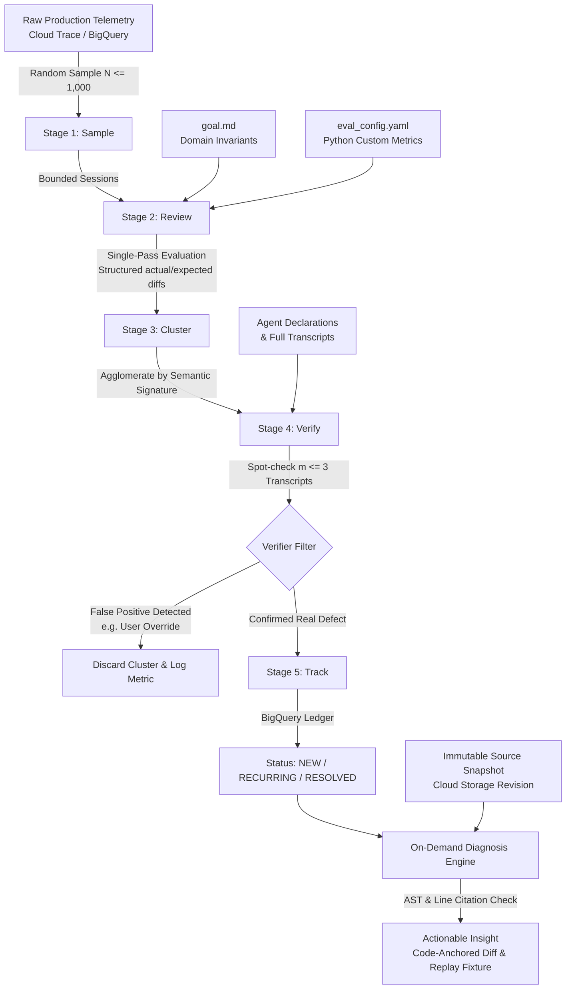

# Case Study 31: Ambient Quality Engineering & The Production Outer Loop — AQuA Architecture, Continuous Telemetry Sweeping, and Code-Anchored Root-Cause Diagnosis

> **Core Focus**: Designing, implementing, and operating production-grade **Ambient Quality Systems** for autonomous agents and multi-agent meshes. Resolving the critical "remaining 20%" reliability wall where production agents return `HTTP 200 OK`, latency budgets remain green, and zero infrastructure exceptions are thrown, yet catastrophic semantic degradation occurs silently in the conversation. Comprehensive architectural blueprint covering **The Dual-Loop Quality Paradigm** (Fast Inner Loop vs. Ambient Outer Loop), **The AQuA (Ambient Quality Agent) Sidecar Architecture** (out-of-band telemetry analysis without request-path latency), **The Five-Stage Sweep & Verification Pipeline** (Sample $\to$ Single-Pass Checklist Review $\to$ Failure Mechanism Clustering $\to$ Transcript Verification $\to$ State Tracking), **Deploy-Time Source Snapshot Ledgers** with AST-validated line-anchored root-cause diagnosis (`<path>:<start>-<end>`), and **Closed-Loop Remediation Flywheels** directly feeding developer coding agents (Antigravity, Gemini CLI, Claude Code, Cursor) and deterministic replay runners.

---

## 1. Executive Summary & The Paradigm Shift: The "HTTP 200 OK" Silent Failure Trap

Building an autonomous agent or multi-agent system to handle initial benchmarks and anticipated user journeys is relatively straightforward today. Armed with an evaluation dataset, a modern coding agent, and a tight developer inner loop (**run $\to$ grade $\to$ fix $\to$ compare**), engineering teams routinely achieve $80\%$ task success on known test scenarios in days.

Then the system ships to production.

```
                   THE PRE-LAUNCH VS. POST-LAUNCH QUALITY PARADOX

      100% ┌──────────────────────┐
           │                      │
       80% │          ┌───────────┘◄── Pre-Launch Inner Loop: Rapid climb to 80%
           │         /
           │        /
       60% │       /              ┌── Production Reality: Ground shifts, quality
           │      /               │   fluctuates, edge cases multiply (HTTP 200 OK)
       40% │     /                ▼
           │    /           ~~~~~~~~~~~~~~~
           │   /            \  /\    /\   /
       20% │  /              \/  \  /  \ /
           │ /                    \/    V
        0% └─┴──────────────┴───────────────┴───────────────►
             Development       Launch        Production Time
```

Once real traffic hits, the quality curve flattens or silently degrades. What makes the remaining $20\%$ uniquely difficult is that **the ground moves beneath the agent**:
1. **User Behavior Divergence**: Live enterprise users deviate fundamentally from synthetic eval suites, combining commands, changing parameters mid-dialogue, volunteering unprompted information, or requesting counter-factual workflows.
2. **Infrastructure Decoupling (The Silent Failure Trap)**: In traditional microservice architectures, an operational bug manifests as a `5xx` error, an uncaught exception, or a latency spike caught immediately by Datadog or Prometheus. In agentic systems, **the infrastructure stays completely green**:
   - The API returns `HTTP 200 OK`.
   - The request completes well inside p95 latency SLAs.
   - Every tool call succeeds without an exception.
   - **Yet the conversation suffered catastrophic semantic failure**: an airline agent confirmed seat 3A without ever calling the seat inventory subagent to check availability, or a travel assistant recommended Florentine ribeye steak to a customer whose account profile is explicitly marked vegan.
3. **Multi-Layer Causal Confounding**: When an agent interaction derails, isolating the root cause requires disentangling four distinct abstraction layers that look identical from the outside:
   - **The Foundation Model**: Hallucinated a parameter or dropped a context constraint from three turns earlier.
   - **The Orchestration Harness**: Routed to the wrong subagent or dropped session state across turn boundaries.
   - **The Tool Contract**: Rejected an argument because valid enumerated values were omitted from the JSON schema.
   - **The System Instructions / Skills**: Omitted an operational edge-case rule or contradicted the agent's declared tool capabilities.

```
       CONFOUNDED ROOT-CAUSE LAYERS OF AGENTIC CONVERSATIONAL FAILURE

    ┌────────────────────────────────────────────────────────────────────────┐
    │ 1. Model Policy Layer                                                  │
    │    * Attention degradation ("Lost in the Middle")                      │
    │    * Context forgetting across 5+ conversational turns                 │
    ├────────────────────────────────────────────────────────────────────────┤
    │ 2. Orchestration & Harness Layer                                       │
    │    * Erroneous subagent routing / delegation                           │
    │    * Session state serialization mismatch or dropped state keys        │
    ├────────────────────────────────────────────────────────────────────────┤
    │ 3. Tool Contract Layer                                                 │
    │    * Missing enum declarations in OpenAPI / JSON Schema                │
    │    * Implicit schema assumptions not reflected in agent instructions   │
    ├────────────────────────────────────────────────────────────────────────┤
    │ 4. System Instructions & Skill Declarations Layer                      │
    │    * Unwritten business invariants or ambiguous edge-case rules        │
    │    * Contradiction: Instruction demands grounding, but tools=[]        │
    └────────────────────────────────────────────────────────────────────────┘
```

Relying on human engineers to inspect raw telemetry traces at scale is physically impossible when handling thousands of sessions per day. Conversely, standard online scalar dashboards merely alert that an aggregate score moved from $84\%$ to $81\%$, offering zero causal attribution as to *why* or *which code commit* caused the regression.

### The Solution: The Dual-Loop Quality Paradigm

To bridge this chasm, Google Cloud AI open-sourced **AQuA (Ambient Quality Agent)** within `adk-recipes`. AQuA introduces **The Outer Loop**, a decoupled, autonomous quality agent running out-of-band beside production workloads. While the **Inner Loop** optimizes candidate builds through local evaluation and coding agents, the **Outer Loop** continuously sweeps live production telemetry, clusters recurring failure mechanisms, verifies them against multi-turn session transcripts, and maps root causes directly to line ranges in the deployed code snapshot.

```
                    THE DUAL-LOOP QUALITY FLYWHEEL

    ┌───────────────────────────────────────────────────────────────────────┐
    │                           THE OUTER LOOP                              │
    │                   (Production Ambient Quality - AQuA)                │
    │                                                                       │
    │     Production Traffic ──► OpenTelemetry Spans / BigQuery             │
    │                                    │                                  │
    │                                    ▼                                  │
    │                       1. Sample (Cost-Bounded)                        │
    │                                    │                                  │
    │                                    ▼                                  │
    │                       2. Review (Single-Pass 9-Pt Rubric)             │
    │                                    │                                  │
    │                                    ▼                                  │
    │                       3. Cluster (Failure Mechanisms)                 │
    │                                    │                                  │
    │                                    ▼                                  │
    │                       4. Verify (Dual-Model Transcript Spot-Check)    │
    │                                    │                                  │
    │                                    ▼                                  │
    │                       5. Track (NEW / RECURRING / RESOLVED)           │
    │                                    │                                  │
    │                                    ▼                                  │
    │                       Diagnose (Anchored to Deployed Snapshot)        │
    └────────────────────────────────────┬──────────────────────────────────┘
                                         │
                 Anchored Edits & Replay │ Replayable User Turns
                 Insight Artifacts       │ (adk run --replay)
                                         ▼
    ┌───────────────────────────────────────────────────────────────────────┐
    │                           THE INNER LOOP                              │
    │                  (Developer / Coding Agent Workspace)                 │
    │                                                                       │
    │        Developer / Coding Agent (Antigravity, Gemini CLI, Claude)     │
    │                                    │                                  │
    │                                    ▼                                  │
    │                          Apply Anchored Patch                         │
    │                                    │                                  │
    │                                    ▼                                  │
    │                         Local Replay Verification                     │
    │                                    │                                  │
    │                                    ▼                                  │
    │                       CI/CD Quality Gate & Deploy                     │
    └───────────────────────────────────────────────────────────────────────┘
```

---

## 2. Theoretical & Mathematical Foundations

### 2.1 Multi-Turn Production Agent POMDP Formulation

We model the production agentic workflow as a **Partially Observable Markov Decision Process (POMDP)** extended across multiple conversational turns and tool invocations:

$$
\mathcal{M} = \langle \mathcal{S}, \mathcal{A}, \mathcal{O}, \mathcal{T}, \mathcal{R}, \Omega, \gamma \rangle
$$

Where:
- $\mathcal{S}$ represents the unobserved global world state (enterprise databases, user account records, seat inventories, flight availability, and ephemeral session memory).
- $\mathcal{A} = \mathcal{A}_{\text{dialogue}} \cup \mathcal{A}_{\text{tool}} \cup \mathcal{A}_{\text{delegate}}$ is the hybrid action space of the agent: emitting conversational tokens to the user, executing tool calls against external APIs, or delegating tasks across subagent boundaries.
- $\mathcal{O}$ is the observation space: user query inputs, tool execution payloads, and subagent return messages.
- $\mathcal{T}(s' \mid s, a)$ is the environment transition function.
- $\Omega(o \mid s', a)$ is the observation probability distribution.
- $\mathcal{R}(s, a)$ is the true business utility (task completion, correctness, customer satisfaction).

A complete interaction session is recorded as a causal trajectory $\tau$:

$$
\tau = \left( u_1, a_1, o_1, \Delta \sigma_1, u_2, a_2, o_2, \Delta \sigma_2, \dots, u_T, a_T, o_T, \Delta \sigma_T \right)
$$

Where $u_t$ is the user utterance at turn $t$, $a_t$ is the agent action, $o_t$ is the tool or environment observation, and $\Delta \sigma_t$ is the internal session state delta committed by the agent.

---

### 2.2 Semantic Loss Function & Conversational Defect Manifold

In traditional software systems, a binary failure signal $\mathcal{E}(\tau) \in \{0, 1\}$ is emitted deterministically by runtime exceptions:

$$
\mathcal{E}_{\text{infra}}(\tau) = \mathbb{I}(\text{HTTP\_Status} \ge 500 \lor \text{UnhandledException})
$$

In autonomous agents, infra health check is orthogonal to task success:

$$
\mathcal{E}_{\text{infra}}(\tau) = 0 \quad \text{does not imply} \quad \mathcal{L}_{\text{semantic}}(\tau) = 0
$$

We define the **Semantic Loss Indicator** $\mathcal{L}_{\text{semantic}}(\tau)$ through an out-of-band evaluation mapping over the trajectory space:

$$
\mathcal{L}_{\text{semantic}}(\tau) = \max_{k \in \mathcal{K}} \psi_k(\tau, \mathcal{G}, \mathcal{P}_{\text{deploy}})
$$

Where:
- $\mathcal{K} = \{1, \dots, 9\}$ represents the canonical nine-point failure rubric categories (procedural compliance, tool selection/arguments, grounding, inter-agent delegation, constraint preservation, state synchronization, task completion, safety/guardrails, and fallback recovery).
- $\mathcal{G}$ represents the plain-text developer invariant specification (`goal.md`).
- $\mathcal{P}_{\text{deploy}}$ represents the deployed system instructions and tool definitions.
- $\psi_k \in \{0, 1\}$ indicates whether rubric $k$ was violated.

When $\psi_k(\tau) = 1$, the evaluator outputs a structured finding tuple:

$$
f_i = \langle \tau_i, \text{agent}, t, k, \text{actual}, \text{expected}, \sigma_{\text{span}} \rangle
$$

---

### 2.3 Semantic Clustering via Information-Theoretic Mechanism Grouping

Let $\mathcal{F} = \{f_1, f_2, \dots, f_M\}$ be the set of structured findings extracted from a sampled sweep of $N$ production trajectories ($M \ge N$ as a single trajectory can exhibit multiple defects).

The goal of Stage 3 (Clustering) is to partition $\mathcal{F}$ into $K$ mutually disjoint candidate clusters $\{C_1, C_2, \dots, C_K\}$ maximizing the mutual information between the failure mechanism signature and the cluster assignment:

$$
\max \mathcal{I}(C; \mathcal{M}_{\text{causal}}) = \sum_{c \in C} \sum_{m \in \mathcal{M}} P(c, m) \log \frac{P(c, m)}{P(c)P(m)}
$$

In practice, this is realized by extracting a dense semantic embedding vector $\mathbf{v}_i = \mathbf{E}(\text{agent}_i \oplus k_i \oplus \text{actual}_i \oplus \text{expected}_i) \in \mathbb{R}^d$ and applying agglomerative hierarchical clustering subject to a cosine similarity threshold $\theta_{\text{cluster}}$:

$$
\text{dist}(f_i, f_j) = 1 - \frac{\mathbf{v}_i \cdot \mathbf{v}_j}{\|\mathbf{v}_i\|_2 \|\mathbf{v}_j\|_2} \le \theta_{\text{cluster}}
$$

Each candidate cluster $C_k$ is represented by an aggregated failure signature and an associated set of affected session IDs $\mathcal{S}_k = \{\tau \mid f \in C_k, f \in \tau\}$.

---

### 2.4 Sequential Hypothesis Testing & Two-Stage Verification

Model judges operating on single sessions inevitably exhibit non-zero Type I error rates ($\alpha$, false positive discoveries):
- Merging disparate errors under vague semantic similarity.
- Overlooking explicit user overrides (e.g., user commanded: *"I do not care about seat selection, just give me whatever seat is free"*).

To guarantee that unverified hypotheses never masquerade as verified insights, AQuA implements a **sequential verification filter**. For each candidate cluster $C_k$, an adversarial verification judge (running a separate high-reasoning model such as Gemini 3.7 Flash) inspects a spot-check subset of full transcripts $\mathcal{E}_k \subset \mathcal{S}_k$ where $|\mathcal{E}_k| \le m_{\text{cap}}$ (empirically $m_{\text{cap}} = 3$):

$$
\mathcal{V}(C_k) = \begin{cases}
1 & \text{if } \sum_{\tau \in \mathcal{E}_k} \mathbb{I}(\text{Defect}(\tau, C_k) = \text{True}) = |\mathcal{E}_k| \\
0 & \text{otherwise}
\end{cases}
$$

Let $p_{\text{fp}}$ be the probability that a single transcript is judged as failing when the agent behaved correctly. The probability that a spurious cluster survives spot-checking across $m$ independent full transcripts drops exponentially:

$$
P(\text{False Positive Cluster Survives}) \le (p_{\text{fp}})^m
$$

For $p_{\text{fp}} = 0.15$ and $m = 3$, the false-positive cluster acceptance rate drops to:

$$
P(\text{FP}) \le (0.15)^3 = 0.003375 \quad (0.34\%)
$$

This dual-stage verification ensures that only mathematically grounded failure patterns enter the developer's triage queue.

---

### 2.5 Causal Attribution & Line-Anchored Source Projection

When a verified insight $I_k$ is approved for investigation, the diagnosis engine maps the conversational breakdown to the deployed source tree. Let $\mathcal{R}_{\text{snap}}$ be the immutable Git repository snapshot captured at deploy time, containing files $\{F_1, F_2, \dots, F_P\}$.

We formulate root-cause diagnosis as a causal projection function $\Pi$:

$$
\Pi(I_k, \mathcal{R}_{\text{snap}}) \to \begin{cases}
\langle F_p, l_{\text{start}}, l_{\text{end}}, \Delta_{\text{patch}} \rangle & \text{if defect is internal to codebase} \\
\langle \text{ExternalStep}, \text{Provider}, \text{Payload} \rangle & \text{if defect is upstream / external}
\end{cases}
$$

The server enforces an AST and line-coordinate validity constraint:

$$
\text{ValidCitation}(F_p, l_{\text{start}}, l_{\text{end}}) \iff (F_p \in \mathcal{R}_{\text{snap}}) \land (1 \le l_{\text{start}} \le l_{\text{end}} \le \text{TotalLines}(F_p))
$$

Any proposed citation violating this predicate is rejected immediately, preventing synthetic line hallucinations from polluting developer diffs.

---

## 3. AQuA Sidecar Architecture & System Topologies

AQuA is engineered as an out-of-band **sidecar runtime** deployed within the user's Google Cloud project. It does **not** sit in the live request path, adds **zero latency** to client invocations, and holds **read-only** permissions over production telemetry.

```
                  AQUA PRODUCTION SIDECAR ARCHITECTURE IN GCP

    ┌────────────────────────────────────────────────────────────────────────┐
    │                           GOOGLE CLOUD PROJECT                         │
    │                                                                        │
    │   User Request                                                         │
    │        │                                                               │
    │        ▼                                                               │
    │   ┌─────────────────────────────────────┐                              │
    │   │      Production Agent (Cloud Run)   │                              │
    │   │  (travel_concierge, ADK, LangGraph) │                              │
    │   └──────────────────┬──────────────────┘                              │
    │                      │                                                 │
    │                      │ Asynchronous Telemetry Ingestion (Zero Latency) │
    │                      ▼                                                 │
    │   ┌─────────────────────────────────────────────────┐                  │
    │   │ Cloud Trace / Cloud Logging / BigQuery Dataset  │                  │
    │   │ (OpenTelemetry GenAI Spans & Multi-Turn Trajs)  │                  │
    │   └────────────────────────┬────────────────────────┘                  │
    │                            │                                           │
    │                            │ Scheduled / On-Demand Sweep               │
    │                            ▼                                           │
    │   ┌─────────────────────────────────────────────────┐                  │
    │   │      AQuA Sweep Runner (Cloud Run Job)          │                  │
    │   │                                                 │                  │
    │   │  Stage 1: Sample (Random / Bounded Budget)      │                  │
    │   │  Stage 2: Review (Single-Pass 9-Pt Rubric)      │                  │
    │   │  Stage 3: Cluster (Failure Mechanism Signatures)│                  │
    │   │  Stage 4: Verify (Dual-Model Transcript Check)  │                  │
    │   │  Stage 5: Track (BigQuery Insights Ledger)      │                  │
    │   └────────────┬──────────────────────┬─────────────┘                  │
    │                │                      │                                │
    │   Deploy Snap  │                      │ Persist Verified               │
    │   (Cloud Store)│                      │ Insights                       │
    │                ▼                      ▼                                │
    │       ┌─────────────────┐    ┌─────────────────┐                       │
    │       │ Cloud Storage   │    │ BigQuery        │                       │
    │       │ Source Snapshot │    │ aqua_insights   │                       │
    │       │ (Revision Keyed)│    │ aqua_runs       │                       │
    │       └────────┬────────┘    └────────┬────────┘                       │
    │                │                      │                                │
    │                └───────────┬──────────┘                                │
    │                            │                                           │
    │                            ▼                                           │
    │   ┌─────────────────────────────────────────────────┐                  │
    │   │      AQuA Dashboard & Headless RPC Server       │                  │
    │   │        (Cloud Run behind Google Cloud IAP)      │                  │
    │   └────────────────────────┬────────────────────────┘                  │
    └────────────────────────────┼───────────────────────────────────────────┘
                                 │
                   Authenticated │ Identity-Aware Proxy (IAP)
                                 ▼
    ┌────────────────────────────────────────────────────────────────────────┐
    │                         DEVELOPER WORKSPACE                            │
    │                                                                        │
    │  Web Browser Console (Chat / Diff Inspection)                          │
    │  agents-cli / Antigravity / Gemini CLI / Claude Code / Cursor          │
    └────────────────────────────────────────────────────────────────────────┘
```

### Architectural Tenets of the Sidecar

1. **Zero Critical-Path Intrusion**: AQuA never intercepts or wraps user requests. If AQuA suffers an internal failure, production agent traffic continues unabated.
2. **Project-Local Data Sovereign Boundary**: All conversation transcripts, OpenTelemetry GenAI spans, BigQuery records, and source snapshots remain strictly contained within the customer's cloud boundary under enterprise Identity-Aware Proxy (IAP) governance.
3. **Immutable Deploy-Time Snapshot Pinning**: During CI/CD deployment (`agents-cli deploy`), the build system archives an immutable snapshot of the active Git repository to Google Cloud Storage keyed by the deployment revision ID (`gs://my-bucket/snapshots/rev_4821a.tar.gz`). When AQuA diagnoses a failure occurring in revision 4821a, it evaluates the code as it existed at the time of execution, completely immune to subsequent local edits or branch switches.
4. **Read-Only Non-Mutating Security Model**: AQuA never commits code, mutates live agent configurations, or opens unauthorized pull requests. It functions strictly as an ambient diagnostic instrument, delivering verified insights, AST citations, and unified diff patches directly to the developer or coding agent.

---

## 4. The Five-Stage Sweep and Verification Pipeline

Each scheduled or post-deployment AQuA run executes a rigorous, multi-stage processing pipeline designed to convert raw, noisy conversational telemetry into high-confidence, actionable defect files.



### Stage 1: Sample (Cost-Bounded Predictability)
Evaluating complex multi-turn agent interactions using frontier LLMs carries token costs. Evaluating 50,000 sessions daily with full trajectory judges would incur prohibitive expense. AQuA samples up to $1,000$ recent sessions per sweep using uniform random sampling (`ORDER BY RAND()`). This bounds the total token compute and makes cost entirely predictable.

### Stage 2: Review (Single-Pass 9-Point Rubric)
Instead of executing separate judge calls for every metric (which multiplies token consumption by $N$ metrics), AQuA utilizes the **single-pass `session_review` judge**. In **one single model call per session**, the judge evaluates the entire trajectory against a canonical 9-point failure checklist:

| Check # | Rubric Category | Focus of Verification |
|---|---|---|
| **1** | **Procedural Adherence** | Did the agent skip mandatory intermediary tools or subagents (e.g. seat inventory check)? |
| **2** | **Tool Selection & Arguments** | Were appropriate tools selected with valid, schema-compliant arguments? |
| **3** | **Context Grounding** | Are factual claims (prices, flight numbers, hours) grounded in tool output or fabricated? |
| **4** | **Inter-Agent Delegation** | Did subagent handoffs preserve essential conversational state and parameters? |
| **5** | **Constraint Preservation** | Did subsequent turns violate preferences established earlier (e.g., vegan dietary rules)? |
| **6** | **State Synchronization** | Does the internal session state ledger match the conversationally agreed actions? |
| **7** | **Task Completion** | Was the end-to-end user intent completely satisfied without premature truncation? |
| **8** | **Safety & Guardrails** | Did the agent honor security boundaries and avoid unauthorized system actions? |
| **9** | **Fallback & Recovery** | Did the agent gracefully handle external tool errors or downstream timeouts? |

Alongside the 9-point rubric, the reviewer evaluates:
- **`goal.md`**: High-level domain invariants provided by developers (e.g., *"Ignore small talk and browsing drop-offs; focus on mid-conversation flight updates"*).
- **Custom Deterministic Metrics (`eval_config.yaml`)**: Zero-token Python scripts that compute pass/fail flags for strict rule violations.

When a session fails, Stage 2 outputs structured `actual` and `expected` statements citing specific conversational turns and OpenTelemetry span IDs.

### Stage 3: Cluster (Failure Mechanism Grouping)
Individual session findings are grouped by semantic mechanism rather than raw text matching. Findings sharing the same underlying failure signature (e.g. `bypass_seat_selection_on_volunteered_seat`) are merged into candidate issue clusters. The cluster maintains:
- Canonical failure summary.
- Responsible agent / subagent identifier.
- Total affected session count (used for priority ranking).
- List of linked session IDs.

### Stage 4: Verify (Dual-Model Transcript Spot-Checking)
Candidate clusters are claims, not verified facts. To eliminate hallucinations from the Stage 2 reviewer and filter out user-directed deviations, Stage 4 launches an adversarial verifier (e.g., Gemini 3.7 Flash).

The verifier pulls up to **three full session transcripts** for each candidate cluster. It reads the raw user turns, agent responses, and tool payloads against the agent's system prompt:
- If all three transcripts exhibit the defect and violate the agent's instructions, the cluster is **verified**.
- If in even one transcript the user explicitly told the agent to override standard behavior (e.g., *"Skip seat selection"*), or if the cluster merged two unrelated tool errors, the cluster is **rejected as a false positive** and explicitly logged on the run record.

### Stage 5: Track (Insight State Lifecycle)
Surviving verified clusters are synchronized against the BigQuery insights table:

```
                      AQUA INSIGHT LIFECYCLE STATE MACHINE

                   ┌───────────────────────────────┐
                   │    Verified Cluster Sweep     │
                   └───────────────┬───────────────┘
                                   │
                                   ▼
                   ┌───────────────────────────────┐
                   │       Matching Insight?       │
                   └───────┬───────────────┬───────┘
                     No    │               │  Yes
            ┌──────────────┘               └──────────────┐
            ▼                                             ▼
    ┌───────────────┐                             ┌───────────────┐
    │  Status: NEW  │                             │   Dismissed?  │
    └───────┬───────┘                             └───────┬───────┘
            │                                             │ No
            │ Next Sweep Matches                          ▼
            └─────────────────────────────────────►┌───────────────┐
                                                   │   RECURRING   │
                                                   └───────┬───────┘
                                                           │
                                                           │ Unseen for
                                                           │ 14 Days (TTL)
                                                           ▼
                                                   ┌───────────────┐
                                                   │   RESOLVED    │
                                                   └───────────────┘
```

- **`NEW`**: First discovery of a verified failure pattern.
- **`RECURRING`**: Re-observed in subsequent telemetry sweeps.
- **`RESOLVED`**: Automatically marked resolved after 14 consecutive days without observation in sweeps.
- **`DISMISSED`**: Manually dismissed by an engineer as intended product behavior. Once dismissed, future sweeps **never** reopen the finding as `NEW`.

---

## 5. Real-World Case Study: Multi-Agent Sweep on Travel-Concierge

To validate AQuA under production enterprise conditions, Google Cloud AI evaluated the reference **`travel-concierge`** multi-agent application (`google/adk-recipes`).

`travel-concierge` orchestrates user journeys across eight specialized subagents:
- `inspiration_agent`: Explores destinations and activities.
- `place_agent`: Queries city venues, dining, and landmarks.
- `poi_agent`: Retrieves point-of-interest details with map grounding.
- `planning_agent`: Assembles end-to-end trip itineraries.
- `flight_search_agent`: Locates available flight segments.
- `flight_seat_selection_agent`: Queries live aircraft cabin maps and verifies seat availability.
- `booking_agent`: Finalizes ticketing and reservation commits.
- Session memory is coordinated via state hooks (`memorize(key, value)`).

### 5.1 Deployment & Baseline Sweep (Revision 1)

Attaching AQuA to `travel-concierge` required three CLI commands:
```bash
agents-cli extension add "${AQUA_CHECKOUT}"
agents-cli infra single-project --project="${GOOGLE_CLOUD_PROJECT}" --apply
agents-cli deploy --project="${GOOGLE_CLOUD_PROJECT}" --region us-east1
```

During deploy, an immutable source snapshot of all 33 files was captured to Cloud Storage as **Revision 1**. A plain-text developer goal was saved:

```markdown
Goal: Help travelers move from trip inspiration to a concrete itinerary and confirmed bookings
across our sub-agents, with every confirmed flight, hotel, seat, and recommendation grounded in
tool results and the traveler's profile.

Failure modes to make sure we cover:
- Mid-conversation changes: if a user updates destination, dates, or flight/hotel choices,
  make sure subsequent sub-agent tool calls and state updates reflect the change.
- Dropped context when handing off or delegating across inspiration_agent, planning_agent,
  and booking_agent (such as traveler profile preferences or prior selections).

Ignore: tone, greetings, small talk, or sessions where the user browses and leaves without booking.
```

A sweep of **32 multi-agent sessions** (replaying four scripted traveler journeys generating 1,583 OpenTelemetry spans) was executed.

### 5.2 Sweep Results & Discovery of Three Silent Failure Archetypes

Only **5 out of 32 sessions passed cleanly**. The remaining 27 produced 42 structured findings. Clustering aggregated these into 9 candidate clusters. The adversarial verifier rejected **3 false-positive clusters**, leaving **6 verified insights**:

```
                       REVISION 1 VERIFIED INSIGHT RANKING

    Rank  Affected Sessions  Responsible Agent    Failure Mechanism
    ───────────────────────────────────────────────────────────────────────────────────
     #1      15 sessions     planning_agent       Implicit Precondition Bypass (Seats)
     #2       7 sessions     inspiration_agent    Cross-Agent Context Dropping (Vegan)
     #3       5 sessions     poi_agent            Prompt-to-Toolset Contradiction
```

#### Archetype A: Implicit Precondition Bypass (Tool Skipping under User Coercion)
- **Observed Behavior**: When a traveler selected outbound flight UA204 and volunteered: *"I want seat 3A"*, `planning_agent` directly wrote `selected_seats = ["3A"]` into session memory and returned `HTTP 200 OK` without invoking `flight_seat_selection_agent`.
- **Silent Defect**: The agent bypassed seat verification. In reality, seat 3A was an occupied premium seat requiring an uncollected fee.
- **Root Cause**: `travel_concierge/sub_agents/planning/prompt.py:93`. The prompt instructions directed the agent to call `flight_seat_selection_agent` *only when rendering an interactive seat map*, failing to handle the branch where the user proactively names a seat.

#### Archetype B: Cross-Subagent Context Dropping (Delegation Amnesia)
- **Observed Behavior**: The traveler's account profile contained `food_preference: vegan`. When `inspiration_agent` asked `place_agent` for culinary recommendations in Florence, it failed to pass the profile attribute. `place_agent` enthusiastically recommended *Bistecca alla Fiorentina (Florentine T-bone steak)*.
- **Silent Defect**: Inter-agent tool delegation wrapper failed to propagate session context.
- **Root Cause**: `travel_concierge/sub_agents/inspiration/prompt.py:23`. The delegation helper method neglected to inject session state variables into the downstream tool invocation.

#### Archetype C: Prompt-to-Toolset Specification Contradiction
- **Observed Behavior**: `poi_agent` fabricated placeholder URLs (`https://example.com/attraction`).
- **Silent Defect**: Model hallucination induced by impossible system instructions.
- **Root Cause**: `travel_concierge/sub_agents/poi/agent.py:12`. The prompt mandated verified Google Maps Grounding Lite fields, but the agent was declared in code with an empty tool array (`tools=[]`). Having no physical tool to call, the model hallucinated URLs to satisfy the prompt promptings.

---

### 5.3 Closing the Loop: Headless Coding Agent Remediation (Revision 2)

A developer or coding agent (Antigravity, Gemini CLI, Claude Code) retrieves the insight payload headlessly via CLI:

```bash
# 1. Fetch new high-impact insights affecting >= 10 sessions
agents-cli aqua list-insights --status NEW --root-cause false \
  | jq -r '.insights | sort_by(-.trace_count) | .[] | select(.trace_count >= 10) | "\(.insight_id)  \(.label)"'

# 2. Trigger automated root-cause analysis anchored to Revision 1 source snapshot
agents-cli aqua run 'Diagnose insight 220d9209e27d4e16a73b4ad4741caa81. What is the root cause and proposed fix?'
agents-cli aqua get-insight 220d9209e27d4e16a73b4ad4741caa81 > insight.json

# 3. Extract user query sequence for deterministic replay
jq '{state: {}, queries: [.occurrences[0].rubrics[0].trace[] | select(.role == "user") | .content]}' \
  insight.json > ./failing_journey_replay.json

# 4. Verify locally using ADK replay harness
adk run --replay ./failing_journey_replay.json travel_concierge
```

```
               BEFORE VS. AFTER REMEDIATION (REVISION 1 VS. REVISION 2)

    Metric                          Revision 1 (Pre-AQuA)    Revision 2 (Post-AQuA Fix)
    ───────────────────────────────────────────────────────────────────────────────────
    Clean Passing Sessions                  5 / 32 (15.6%)            13 / 32 (40.6%)
    Seat Selection Bypass Failures         15 sessions                 2 sessions  (-87%)
    Vegan Profile Omission Failures         7 sessions                 0 sessions (-100%)
    Untouched POI Tool Defect               5 sessions                 5 sessions (Tracked)
```

Applying the two code-anchored one-line fixes (`planning/prompt.py:93` and `inspiration/prompt.py:23`) slashed seat bypass failures by $87\%$, completely eradicated dietary omission bugs, and more than doubled the end-to-end session pass rate.

---

## 6. Trust Engineering & Epistemic Rigor

A diagnostic agent that inspects other agents will occasionally make mistakes. If an evaluation system generates spurious warnings or hallucinated code locations, engineering teams quickly disable it. AQuA enforces four foundational **trust engineering principles**:

```
                       AQUA TRUST ENGINEERING FRAMEWORK

    ┌───────────────────────────────────┐    ┌───────────────────────────────────┐
    │ 1. Claims vs. Verified Findings   │    │ 2. Grounding via Valid Citations  │
    │    Clusters remain claims until   │    │    No arbitrary "confidence: 0.8" │
    │    spot-checked against full      │    │    Insight defined strictly by    │
    │    session transcripts.           │    │    spans and AST line bounds.     │
    └─────────────────┬─────────────────┘    └─────────────────┬─────────────────┘
                      │                                        │
                      └───────────────────┬────────────────────┘
                                          │
                                          ▼
    ┌───────────────────────────────────┐    ┌───────────────────────────────────┐
    │ 3. Explicit Run Accounting        │    │ 4. Deterministic Dismissal State  │
    │    All skipped sessions, rubric   │    │    Dismissed insights are pinned  │
    │    timeouts, and rejected         │    │    permanently and never reopen   │
    │    clusters are audited on run.   │    │    as NEW in future sweeps.       │
    └───────────────────────────────────┘    └───────────────────────────────────┘
```

1. **No Hallucinated Confidence Scores**: The AQuA schema contains no self-reported `confidence: 0.92` field. Large language models are poorly calibrated estimators of their own accuracy. Instead, **an insight is defined strictly by its empirical evidence**: its linked session trace IDs in Cloud Trace and its AST line coordinates validated against the snapshot.
2. **Server-Side Line Coordinate Validation**: When the diagnosis engine cites `<file>:<start_line>-<end_line>`, the server loads the deploy snapshot AST and verifies that the file exists and the lines fall within file bounds. Any citation referencing a nonexistent file or out-of-bounds line is instantly rejected.
3. **Explicit Accounting on the Run Record**: If a sweep encounters trace ingestion timeouts, clusters exceeding the 50-cluster verification cap, or rubric evaluation errors, these are explicitly recorded in `aqua_runs` rather than silently swept into passing statistics.
4. **Permanent Dismissal State**: When a human engineer reviews an insight and clicks **Dismiss** (e.g. confirming that an apparent constraint drop was intentional product behavior), that failure signature is cryptographically stored in BigQuery. Subsequent sweeps will **never** resurrect the issue as `NEW`.

---

## 7. Cost, Token Economics, and Latency Profile

AQuA is engineered to keep production observation expenses at a small fraction of the production agent's operating cost.

### 7.1 Multi-Model Pricing Tier Strategy

AQuA utilizes a three-tier model hierarchy matching reasoning intensity to pipeline stage:

| Pipeline Stage | Model Employed | Operational Focus | Typical Input/Output Tokens per Run |
|---|---|---|---|
| **Stage 2: Review & Clustering** | **Gemini 3.1 Pro** | Broad multi-turn context reading; 9-point rubric adherence; structured finding diffs | $1.6\text{M}$ input / $128\text{K}$ output |
| **Stage 4: Verification** | **Gemini 3.7 Flash** | High-speed adversarial cross-checking against 3 transcripts per cluster | $1.1\text{M}$ input / $37\text{K}$ output |
| **On-Demand Diagnosis** | **Gemini 3.8 Flash** | Deep code reasoning over 30+ repository snapshot files; unified diff synthesis | $150\text{K}$ input / $4\text{K}$ output per insight |

### 7.2 Measured Sweep Cost Breakdown

On an enterprise 96-session single-agent sweep ($5\text{--}6$ spans per session):
- Review, Clustering, and Verification: **$0.70 total** ($\approx \$0.007$ per session).

On the 32-session multi-agent `travel-concierge` sweep ($1,583$ spans across 8 subagents; $\approx 50$ spans per session):
- Stage 2 Review & Stage 3 Clustering (Gemini 3.1 Pro): $\$2.85$
- Stage 4 Verification of 9 candidate clusters (Gemini 3.7 Flash): $\$0.91$
- **Total Scheduled Sweep Cost**: **$3.76** ($\approx \$0.117$ per multi-agent session).
- **On-Demand Root-Cause Diagnosis**: Runs strictly when triggered by an engineer or coding agent, costing **$0.33 to $2.47 per investigated insight**, depending on the number of full trajectory transcripts loaded into context.

---

## 8. Advanced Frontiers & Open Challenges in Agent Quality Engineering

While AQuA establishes the foundational architecture for production outer-loop quality, four major challenges define the frontier of agentic observability:

### 8.1 Needle-in-a-Haystack Session Selection
Random sampling (`ORDER BY RAND()`) is effective for high-frequency failure modes affecting $10\%\text{--}40\%$ of traffic. However, detecting a **critical silent regression that breaks $0.5\%$ of a high-value checkout workflow** across 50,000 daily sessions is challenging without running judges over every session.
- *Emerging Pattern*: **Two-Tier Filtering**. Ingest cheap structural signals (turn count velocity, token spikes, user latency anomalies, sentiment shifts, user thumbs-down from Feedback Service) to compute an anomaly score $S_{\text{anomaly}}(\tau)$, and execute stratified sweeps combining high-anomaly sessions with uniform background baselines.

### 8.2 Long-Horizon Trajectory Compaction
Passing raw multi-turn transcripts into review prompts works seamlessly for $10\text{--}30$ turn dialogues. It collapses when observing **coding agents, research swarms, or data science agents** that run for 500+ turns and consume megabytes of terminal output.
- *Emerging Pattern*: **Hierarchical Trajectory Compaction**. Folding long-horizon execution traces into sub-task milestone Directed Acyclic Graphs (DAGs) and pruning redundant intermediate tool observations while preserving state-delta transitions.

### 8.3 From Transcript Replay to Hermetic Counterfactual Sandboxing
Static transcript replay (`adk run --replay`) re-sends user utterances against local agent code. While effective for idempotent tools, static replay fails when:
1. External database state has moved on (e.g., flight UA204 is now fully booked).
2. Third-party APIs return dynamic data or encounter timeouts.
3. The conversation was branch-dependent: if Turn 2 changes, Turn 3's static user query becomes invalid.
- *Emerging Pattern*: **Hermetic Simulation Sandboxes** (borrowing from Google's [CodeMender](https://cloud.google.com/blog/products/identity-security/find-and-fix-software-vulnerabilities-with-codemender)). Synthesizing isolated microVM sandboxes with mocked tool states and simulated conversational user agents to run dynamic, counterfactual regression suites.

### 8.4 Fleet-Wide Zero-Scaffolding Attachment (1:N Fabric)
Current reference implementations attach AQuA 1:1 beside a single agent repository. Enterprise organizations running hundreds of distinct micro-agents require a centralized ambient quality fabric that attaches across the entire mesh via unified OpenTelemetry collectors without per-repo scaffolding.

---

## 9. Architectural Comparison Matrix

| Dimension | Traditional APM (Datadog, Dynatrace) | Online Managed AutoRaters | Offline Benchmark Evals (SWE-bench, GAIA) | AQuA (Ambient Quality Agent) |
|---|---|---|---|---|
| **Execution Path** | In-request span monitoring | In-request or post-request hook | Offline local developer CLI | Out-of-band asynchronous sidecar sweep |
| **Failure Detection** | `5xx` errors, unhandled exceptions, latency | Scalar rubric scores (1-5 stars) | Unit test pass/fail assertion | Semantic conversational breakdowns (HTTP 200 OK) |
| **Causal Attribution** | Call-stack tracebacks | None (Score only) | Diff pass/fail against test oracle | Causal layer separation (Model vs Harness vs Tool vs Prompt) |
| **Code Anchoring** | Line of thrown exception | None | Git diff under test | Deploy-time snapshot AST line ranges (`<path>:<start>-<end>`) |
| **Noise Filtering** | Alert thresholds | High noise on ambiguous queries | N/A (Static fixtures) | Adversarial dual-model spot-check verification |
| **Remediation Loop** | PagerDuty alerting | Dashboard trend metrics | Local git commit | Direct coding agent export (`insight.json` & `adk replay`) |
| **Request Latency Impact** | Sub-millisecond | $+500\text{ms}\text{--}2,000\text{ms}$ if synchronous | Zero | Zero (Decoupled background batch) |

---

## 10. Executable Reference Architecture

To evaluate the complete AQuA outer-loop pipeline locally, this case study includes a fully functional, self-contained Python reference implementation:

- **[aqua_engine.py](examples/aqua_engine.py)**: Complete implementation of domain models, `SourceSnapshot`, `TelemetrySampler`, `SinglePassReviewer`, `FailureClusterer`, `AdversarialVerifier`, `InsightLedger`, `SourceAnchoredDiagnoser`, and `ReplaySynthesizer`.
- **[test_aqua.py](examples/test_aqua.py)**: Automated unit test suite verifying all 10 core architectural properties (sampling capacity, 9-point rubric review, failure clustering, adversarial rejection of user-override false positives, line citation verification, unified diff generation, ledger state machines, and replay synthesis).
- **[examples/README.md](examples/README.md)**: Execution guide and module documentation.

### Running the Reference Suite Locally

```bash
cd case-studies/31-ambient-quality-agent-production-outer-loop/examples
python -m unittest test_aqua.py
```

Expected output:
```text
..........
----------------------------------------------------------------------
Ran 10 tests in 0.002s

OK
```

---

## 11. Conclusion & Key Architectural Takeaways

1. **The Production Ground Always Shifts**: Pre-launch eval sets solve the first $80\%$ of agent capabilities. Surviving the remaining $20\%$ requires an ambient outer loop that systematically analyzes real production traffic outside the request path.
2. **Infrastructure Health Checks are Blind to Semantic Agent Failure**: An agent returning `HTTP 200 OK` with zero uncaught exceptions can still violate domain invariants, drop customer profile constraints across delegations, or bypass critical tool verifications.
3. **Decouple the Outer Loop from the Critical Path**: Evaluating multi-turn conversational trajectories is computationally intensive. Running quality judges out-of-band via scheduled telemetry sweeps preserves zero client latency and maintains strict cost predictability.
4. **Epistemic Rigor Over Scalar Confidence**: Replace ungrounded model confidence scores with verified trace citations, adversarial spot-checking against full transcripts, and immutable deploy-time AST line validations.
5. **Close the Loop Directly into Coding Agents**: The ultimate measure of an observability system is how frictionlessly it feeds developer remediation. Delivering line-anchored unified diffs and extractable user replay fixtures transforms production failures into deterministic test cases for the developer's inner loop.
