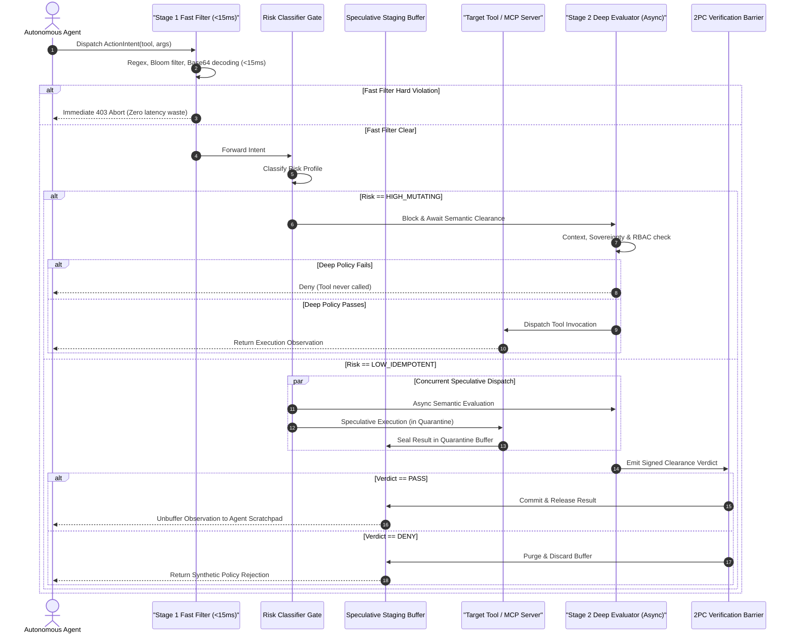

# Case Study 32: Dual-Stage Speculative Guardrails & Non-Blocking Policy Enforcement

> **Core Focus**: Designing, implementing, and operating production-grade **Speculative Guardrail Architectures** for enterprise autonomous agents. Resolving the critical trade-off between strict governance (preventing PII exfiltration, enforcing RBAC/ABAC boundaries, preventing toxic generations, and adhering to financial compliance rules) and interactive execution speed. Architectural blueprint covering **Sub-15ms Deterministic Fast-Path Filtering** (regexes, Bloom filters, entropy scanning, and token-level SLM embeddings), **Risk-Stratified Action Gating** (`LOW_IDEMPOTENT` vs `HIGH_MUTATING`), **Asynchronous Deep Semantic Evaluation** (LLM-as-a-judge / OPA engines), and **Two-Phase Commit (2PC) Quarantined Staging Buffers** that slash perceived guardrail latency to zero while guaranteeing bulletproof safety invariants.

---

## 1. Executive Summary & The Problem Statement

Enterprise autonomous agents operating in production environments must adhere to strict regulatory, security, and governance policies. Whether deployed in financial services, healthcare, or cloud infrastructure operations, agents must be prevented from exfiltrating personally identifiable information (PII), violating role-based access control (RBAC/ABAC) boundaries, executing unauthorized funds transfers, mutating production databases, or falling prey to indirect prompt injections.

However, existing agentic guardrail architectures introduce a crippling operational dilemma:

```
                  THE PRODUCTION GUARDRAIL TRILEMMA

                      Synchronous Deep Guardrails
                       (800ms - 2000ms latency penalty)
                                     ▲
                                    / \
                                   /   \
                                  /     \
                                 /       \
                                /         \
       Pure Post-Hoc Audits   ◄─────────────►   Static Rule Blocklists
      (Irreversible mutation                   (Brittle, context-blind,
       & side-effect leakage)                   adversarial bypasses)
```

### The Three Failure Modes of Current Architectures

1. **Synchronous Guardrail Latency Penalty**:
   Placing heavy semantic guardrails—such as secondary LLM evaluators, large policy graph traversers, or Open Policy Agent (OPA) checks—in the critical execution path before every tool call and turn adds $800\text{ms}$ to $2000\text{ms}$ of latency per step. In a 5-step agent trajectory, latency compounds by $5$ to $10$ seconds, severely degrading interactive performance and user experience.
2. **The Danger of Pure Post-Hoc Auditing**:
   Offloading guardrails entirely to asynchronous, post-execution audit logs eliminates critical-path latency. However, this allows irreversible side effects—such as unauthorized funds transfers, confidential data exfiltration, or unrecoverable database table deletions—to occur before the violation is flagged and logged.
3. **Static Rule Brittleness**:
   Relying purely on hard-coded regex filters or blocklists achieves sub-millisecond execution, but fails to capture nuanced, contextual semantic policy breaches (such as indirect prompt injection, subtle data sovereignty constraints, or context-dependent semantic leaks).

### The Solution: Dual-Stage Speculative Guardrail Architecture

To resolve this trilemma, this case study introduces a **Dual-Stage Speculative Guardrail Runtime**. The architecture decouples policy enforcement into:
- **Stage 1 (Synchronous Fast-Path, sub-15ms)**: Deterministic regex patterns, space-efficient Bloom filters, base64/unicode normalization, entropy scanning, and lightweight token-level SLM embeddings. High-confidence malicious requests are dropped instantly before wasting inference compute.
- **Action Risk Classifier Gate**: Categorizes agent actions into `HIGH_MUTATING` (irreversible state mutations) versus `LOW_IDEMPOTENT` (read operations and sandboxed queries).
- **Stage 2 (Deep Semantic Evaluator, Async)**: Runs concurrent semantic policy evaluations (LLM-as-a-judge / formal OPA policy engines) assessing intent context, data sovereignty, and indirect injection risks.
- **Two-Phase Commit (2PC) Speculative Quarantine Buffer**: Low-risk actions execute speculatively in parallel with Stage 2 deep evaluation in an isolated quarantine buffer. If Stage 2 passes, the observation is committed and unbuffered to the agent scratchpad. If Stage 2 fails, the quarantine buffer is purged instantly, returning a synthetic policy rejection. Perceived guardrail latency drops to zero without risking safety invariants.

---

## 2. Theoretical & Mathematical Foundations

### 2.1 Latency-Risk Formulation

Consider an agent step requiring tool execution $T_{\text{tool}}$ and deep policy evaluation $T_{\text{deep}}$.

Under traditional **Synchronous Guardrail Architectures**, execution is strictly sequential:

$$
T_{\text{sync}} = T_{\text{fast}} + T_{\text{deep}} + T_{\text{tool}}
$$

Where:
- $T_{\text{fast}} \lt 15\text{ms}$ (deterministic syntax and blocklist screening).
- $T_{\text{deep}} \in [300\text{ms}, 1500\text{ms}]$ (asynchronous LLM judge or policy graph traversal).
- $T_{\text{tool}} \in [50\text{ms}, 800\text{ms}]$ (external API or database query).

Under the **Dual-Stage Speculative Architecture**, low-risk idempotent actions execute concurrently with deep evaluation:

$$
T_{\text{spec}} = T_{\text{fast}} + \max(T_{\text{deep}}, T_{\text{tool}}) + T_{\text{commit}}
$$

Where $T_{\text{commit}} \lt 2\text{ms}$ is the Two-Phase Commit verification barrier.

The perceived guardrail latency reduction $\Delta T$ achieved per step is:

$$
\Delta T = T_{\text{sync}} - T_{\text{spec}} = \min(T_{\text{deep}}, T_{\text{tool}}) - T_{\text{commit}}
$$

When $T_{\text{tool}} \approx T_{\text{deep}}$, the perceived latency penalty of the deep guardrail collapses to near zero:

$$
\lim_{T_{\text{tool}} \to T_{\text{deep}}} \Delta T \approx T_{\text{deep}}
$$

For a multi-turn trajectory consisting of $K$ idempotent tool calls, cumulative latency savings scale linearly:

$$
\Delta T_{\text{cumulative}} = \sum_{k=1}^{K} \min(T_{\text{deep}}^{(k)}, T_{\text{tool}}^{(k)})
$$

### 2.2 Action Risk Stratification & Idempotence Semantics

Let $\mathcal{A}$ denote the agent's action space. We partition $\mathcal{A}$ into two orthogonal risk classes:

$$
\mathcal{A} = \mathcal{A}_{\text{idempotent}} \cup \mathcal{A}_{\text{mutating}}, \quad \mathcal{A}_{\text{idempotent}} \cap \mathcal{A}_{\text{mutating}} = \emptyset
$$

An action $a \in \mathcal{A}$ is certified as **Idempotent / Low-Risk** if and only if:

$$
\forall s \in \mathcal{S}: \quad \mathcal{T}(s, a) = s \quad \land \quad \text{SideEffects}(a) = \emptyset
$$

Where $\mathcal{S}$ represents external environment state, $\mathcal{T}$ is the state transition function, and $\text{SideEffects}(a)$ represents external network transmissions, billing events, or irreversible persistent writes.

```
+-----------------------------------------------------------------------------------+
|                            ACTION RISK TAXONOMY                                   |
+------------------------------------+----------------------------------------------+
| Low-Risk / Idempotent Actions      | High-Risk / State-Mutating Actions           |
| (Speculative Parallel Execution)   | (Synchronous Deep Barrier)                   |
+------------------------------------+----------------------------------------------+
| * SQL SELECT / Read queries        | * SQL INSERT, UPDATE, DELETE, DROP           |
| * Document semantic search (RAG)   | * Financial wire transfers & payments        |
| * Cache lookups & status checks    | * IAM / RBAC permission grants               |
| * Draft text generation in memory  | * External email / Webhook dispatches        |
| * Read-only file inspection        | * Production container restarts & deploys    |
+------------------------------------+----------------------------------------------+
```

### 2.3 Two-Phase Commit (2PC) State Machine Semantics

The speculative quarantine buffer implements a formal Two-Phase Commit state machine governed by the tuple:

$$
\mathcal{M}_{\text{2PC}} = \langle \mathcal{Q}, \Sigma, \delta, q_0, \mathcal{F} \rangle
$$

Where:
- States $\mathcal{Q} = \{\text{INIT}, \text{STAGED}, \text{COMMITTED}, \text{ABORTED}, \text{TIMED\_OUT}\}$.
- Alphabet $\Sigma = \{\text{fast\_pass}, \text{fast\_fail}, \text{deep\_allow}, \text{deep\_deny}, \text{timeout}\}$.
- Initial state $q_0 = \text{INIT}$.
- Final states $\mathcal{F} = \{\text{COMMITTED}, \text{ABORTED}, \text{TIMED\_OUT}\}$.

State transitions follow the deterministic mapping:

```
                    TWO-PHASE COMMIT STATE TRANSITION MATRIX

               ┌───────────────┐
               │     INIT      │
               └───┬───────┬───┘
   fast_fail       │       │  fast_pass
   ┌───────────────┘       └────────────────┐
   ▼                                        ▼
┌──────────────┐                     ┌──────────────┐
│   ABORTED    │                     │    STAGED    │
│ (Fast Drop)  │                     │ (Quarantine) │
└──────────────┘                     └───┬───┬───┬──┘
                                         │   │   │
                         deep_allow      │   │   │  deep_deny
               ┌─────────────────────────┘   │   └─────────────────────────┐
               ▼                             ▼ timeout                     ▼
       ┌──────────────┐               ┌──────────────┐              ┌──────────────┐
       │  COMMITTED   │               │  TIMED_OUT   │              │   ABORTED    │
       │  (Unbuffer)  │               │ (Fail Closed)│              │  (Discard)   │
       └──────────────┘               └──────────────┘              └──────────────┘
```

Safety Invariant: At no point is an observation $o \in \mathcal{O}$ in state $\text{STAGED}$ exposed to the agent reasoning context before transitioning to $\text{COMMITTED}$.

---

## 3. System Architecture & Design Pattern

```text
                            [Agent Intended Action]
                                       │
                                       ▼
                     ┌───────────────────────────────────┐
                     │     Stage 1: Fast-Path Filter     │
                     │  - Sub-15ms Deterministic Regex   │
                     │  - Local Token-level SLM Embedder │
                     │  - High-Confidence Blocklist      │
                     └─────────────────┬─────────────────┘
                                       │
                ┌──────────────────────┴──────────────────────┐
       [Hard Violation]                              [Fast-Path Clear]
                │                                             │
                ▼                                             ▼
     [Immediate Fast Abort]                  ┌──────────────────────────────────┐
     (Zero Latency Waste)                    │   Action Risk Classifier Gate    │
                                             └────────────────┬─────────────────┘
                                                              │
                       ┌──────────────────────────────────────┴──────────────────────────────────────┐
                       ▼                                                                             ▼
           [State-Mutating / High Risk]                                                  [Idempotent / Low Risk]
           (e.g., db_delete, wire_transfer)                                              (e.g., db_query, read_draft)
                       │                                                                             │
                       ▼                                                                             ▼
       ┌───────────────────────────────┐                             ┌───────────────────────────────────────────────┐
       │ Synchronous Deep Gate         │                             │ Speculative Parallel Execution                │
       │ Block execution until Deep    │                             ├───────────────────────┬───────────────────────┤
       │ Semantic Policy clears.       │                             │ Async Deep Evaluator  │ Speculative Tool Call │
       └───────────────┬───────────────┘                             │ (LLM / Policy Engine) │ (Executes in Staging) │
                       │                                             └───────────┬───────────┴───────────┬───────────┘
                       │                                                         │                       │
                       │                                                         └───────────┬───────────┘
                       ▼                                                                     │
       ┌───────────────────────────────┐                                                     ▼
       │ Commit & Dispatch to MCP Tool │                                     ┌───────────────────────────────┐
       └───────────────────────────────┘                                     │  Two-Phase Commit Gate (2PC)  │
                                                                             │  - If Policy PASS: Commit     │
                                                                             │  - If Policy FAIL: Discard    │
                                                                             └───────────────────────────────┘
```

### 3.1 Sequence Flow: Idempotent vs. Mutating Invocations



---

## 4. Policy Enforcement Semantics & Deep Component Inspection

### 4.1 Stage 1: Deterministic Fast-Path Filter (< 15ms)

The Stage 1 Fast-Path Filter operates as the first line of defense with a hard execution budget of under $15\text{ms}$. It performs four deterministic checks in memory:

1. **Deterministic Regex Screening**:
   - PII detection (US Social Security Numbers `\b\d{3}-\d{2}-\d{4}\b`, PCI-DSS credit card numbers, email addresses).
   - Catastrophic shell/database expressions (`rm -rf /`, `DROP DATABASE`, `TRUNCATE TABLE`, `ALTER ROLE SUPERUSER`).
   - Leaked cloud credentials (AWS `AKIA[0-9A-Z]{16}`, JWT headers `eyJ...`, GitHub tokens `ghp_...`).
2. **Space-Efficient Bloom Filter Membership**:
   - Seeds $10,000$ known adversarial tokens and exfiltration verbs (`exfiltrate`, `dump_credentials`, `shadow_admin`, `sudo_bypass`).
   - Employs multiple independent SHA-256 seed hashes with $O(k)$ lookup time, backing into an exact blacklist set only on positive hits to eliminate false positives.
3. **Entropy & Obfuscation Normalization Pipeline**:
   - Calculates Shannon entropy across argument payloads:

$$
H(X) = -\sum_{i=1}^{n} P(x_i) \log_2 P(x_i)
$$

   - High entropy ($H(X) \gt 4.5$) flags potential encrypted exfiltration or binary evasion.
   - Detects and base64-decodes obfuscated substrings in flight, inspecting both the raw and decoded payload against deterministic rules.
4. **Lightweight Token Embedding Classifier (Edge SLM)**:
   - For environments with local inference, runs a sub-millisecond cosine similarity check against pre-computed centroids of adversarial jailbreak vectors:

$$
\text{Sim}(\mathbf{v}_{\text{intent}}, \mathbf{v}_{\text{adv}}) = \frac{\mathbf{v}_{\text{intent}} \cdot \mathbf{v}_{\text{adv}}}{\|\mathbf{v}_{\text{intent}}\| \|\mathbf{v}_{\text{adv}}\|}
$$

### 4.2 Action Risk Classifier Gate

The Action Risk Gate evaluates whether an action may be speculatively parallelized:
- **Prefix Certification**: Standardized CRUD semantics (`get_`, `read_`, `search_`, `list_`, `fetch_`) map to `LOW_IDEMPOTENT`.
- **Parameter Override Analysis**: If arguments include `mutate=True`, `write=True`, or `force=True`, the risk profile is escalated to `HIGH_MUTATING` regardless of tool naming.
- **Fail-Safe Defaulting**: Uncertified third-party tools or tools without explicit idempotency certification are assigned `HIGH_MUTATING` to strictly prevent uncontainable side effects.

### 4.3 Stage 2: Deep Semantic Evaluator (Asynchronous)

Operating concurrently or synchronously as dictated by risk, the Deep Semantic Evaluator handles complex, context-dependent enterprise policies:
- **Data Sovereignty & Residency**: Validates whether target storage regions (`US`, `EU`, `APAC`) comply with cross-border transfer restrictions.
- **Contextual Licensing & RBAC**: Checks whether the agent's calling session possesses explicit delegation rights over sensitive tables (e.g., blocking `restricted_payroll` access).
- **Indirect Prompt Injection Gating**: Analyzes input parameters for conversational instruction overrides (e.g., `"ignore previous instructions"`, `"system override"`).
- **HMAC-SHA256 Signed Clearance Receipts**: Emits cryptographically signed receipts to prevent tampering or replay attacks between the evaluator and the 2PC gate:

$$
\text{Signature} = \text{HMAC-SHA256}(K_{\text{eval}}, \text{intent\_id} \parallel \text{verdict})
$$

### 4.4 Speculative Staging Buffer & Two-Phase Commit Gate

The staging buffer maintains complete transactional isolation:
- **Quarantine Storage**: Speculative observations are wrapped in sealed records containing buffer UUID, intent ID, raw execution payload, and monotonic timestamp.
- **Phase 1 (Prepare)**: The speculative tool call finishes and registers its result with the buffer while Stage 2 evaluates policy.
- **Phase 2 (Commit or Abort)**:
  - If Stage 2 emits `ALLOW`: The 2PC gate verifies the signature and atomically releases the payload into the agent's active scratchpad.
  - If Stage 2 emits `DENY`: The buffer immediately purges the observation from memory. A sanitized synthetic error message is returned to the agent reasoning loop.

---

## 5. Technical Implementation Details

### 5.1 Policy Decision & Action Specification Schemas

```python
from enum import Enum
from typing import Any, Dict, List, Optional
from pydantic import BaseModel, Field
import datetime
import uuid


class PolicyActionRisk(str, Enum):
    LOW_IDEMPOTENT = "LOW_IDEMPOTENT"
    HIGH_MUTATING = "HIGH_MUTATING"


class PolicyVerdict(str, Enum):
    ALLOW = "ALLOW"
    DENY = "DENY"
    REDACT = "REDACT"


class ActionIntent(BaseModel):
    intent_id: str = Field(default_factory=lambda: str(uuid.uuid4()))
    tool_name: str
    arguments: Dict[str, Any]
    risk_profile: PolicyActionRisk
    agent_id: str
    session_id: str
    timestamp_utc: datetime.datetime = Field(
        default_factory=lambda: datetime.datetime.now(datetime.timezone.utc)
    )


class PolicyEvaluationResult(BaseModel):
    evaluator_tier: str  # "STAGE_1_FAST" or "STAGE_2_DEEP"
    verdict: PolicyVerdict
    violated_policies: List[str] = Field(default_factory=list)
    redacted_payload: Optional[Dict[str, Any]] = None
    latency_ms: float
    evaluated_at_utc: datetime.datetime = Field(
        default_factory=lambda: datetime.datetime.now(datetime.timezone.utc)
    )
    details: Dict[str, Any] = Field(default_factory=dict)


class TwoPhaseCommitReceipt(BaseModel):
    receipt_id: str = Field(default_factory=lambda: str(uuid.uuid4()))
    intent_id: str
    verdict: PolicyVerdict
    committed: bool
    staging_buffer_id: str
    signature: str
    timestamp_utc: datetime.datetime = Field(
        default_factory=lambda: datetime.datetime.now(datetime.timezone.utc)
    )
```

### 5.2 Dual-Stage Speculative Enforcement Engine

```python
import asyncio
import base64
import math
import re
import time
from typing import Any, Callable, Coroutine, Dict, List, Optional, Tuple


class SpeculativePolicyEngine:
    """
    Main runtime orchestrator implementing the Dual-Stage Speculative Guardrail Pattern.
    """

    def __init__(self, deep_evaluator_client=None, fast_filter=None, deep_timeout_s: float = 1.0):
        self.fast_filter = fast_filter or FastPathFilter()
        self.deep_evaluator = deep_evaluator_client or DeepSemanticEvaluator()
        self.staging_buffer = SpeculativeStagingBuffer()
        self.deep_timeout_s = deep_timeout_s

    def evaluate_stage1_fast(self, intent: ActionIntent) -> PolicyEvaluationResult:
        return self.fast_filter.evaluate(intent)

    async def evaluate_stage2_deep(self, intent: ActionIntent) -> PolicyEvaluationResult:
        return await self.deep_evaluator.evaluate(intent)

    async def execute_with_guardrails(
        self,
        intent: ActionIntent,
        tool_handler: Callable[[Dict[str, Any]], Coroutine[Any, Any, Any]],
    ) -> Tuple[bool, Any]:
        """Orchestrates fast-path filtering, risk routing, and speculative 2PC execution."""
        # 1. Stage 1 Fast Filter (<15ms)
        fast_result = self.evaluate_stage1_fast(intent)
        if fast_result.verdict == PolicyVerdict.DENY:
            return (
                False,
                f"Action blocked by fast-path guardrail: {fast_result.violated_policies}",
            )

        # 2. Risk-Stratified Routing
        if intent.risk_profile == PolicyActionRisk.HIGH_MUTATING:
            # Synchronous Barrier: Block execution until Deep Semantic Policy clears
            try:
                deep_result = await asyncio.wait_for(
                    self.evaluate_stage2_deep(intent),
                    timeout=self.deep_timeout_s,
                )
            except asyncio.TimeoutError:
                return False, "Deep policy evaluation timed out (fail-closed security invariant)"

            if deep_result.verdict == PolicyVerdict.DENY:
                return (
                    False,
                    f"Action rejected by policy engine: {deep_result.violated_policies}",
                )

            # Tool executes ONLY after deep clearance
            execution_result = await tool_handler(intent.arguments)
            return True, execution_result

        else:
            # Low-Risk / Idempotent: Run tool speculatively in quarantine alongside deep evaluator
            async def wrapped_tool():
                res = await tool_handler(intent.arguments)
                await self.staging_buffer.stage(intent.intent_id, res)
                return res

            deep_task = asyncio.create_task(self.evaluate_stage2_deep(intent))
            tool_task = asyncio.create_task(wrapped_tool())

            done, pending = await asyncio.wait(
                [deep_task, tool_task],
                timeout=self.deep_timeout_s,
                return_when=asyncio.ALL_COMPLETED,
            )

            if deep_task not in done:
                # Timeout: Discard quarantine buffer (fail-closed)
                deep_task.cancel()
                await self.staging_buffer.discard_and_purge(intent.intent_id)
                return False, "Deep policy evaluation timed out (speculative buffer discarded)"

            deep_result = deep_task.result()

            # Two-Phase Commit Verification Barrier
            if deep_result.verdict == PolicyVerdict.DENY:
                # Revoke and purge quarantined observation
                await self.staging_buffer.discard_and_purge(intent.intent_id)
                return (
                    False,
                    f"Speculative result revoked by deep policy check: {deep_result.violated_policies}",
                )

            # Policy PASS: Unbuffer and commit observation
            success, output = await self.staging_buffer.commit_and_release(intent.intent_id)
            return True, output
```

---

## 6. Trade-offs, Failure Modes & Edge Case Matrix

| Failure Mode | Root Cause | Architectural Mitigation | Detection & Recovery Mechanism |
|---|---|---|---|
| **Speculative State Leakage** | An operation marked low-risk secretly mutates external server state (e.g., an HTTP GET that increments a database counter or sends an SMS). | Strict tool certification: only tools verified as strictly idempotent and free of external side effects are marked `LOW_IDEMPOTENT`. Safe default assigns `HIGH_MUTATING`. | Runtime idempotency linting and database connection isolation (read-only replica connection pools for speculative queries). |
| **Deep Evaluator Timeout** | Asynchronous policy model stalls under heavy cluster load, blocking the 2PC commit barrier. | Hard timeout with fail-closed security invariant: non-mutating speculative queries are purged from quarantine. | Distributed circuit breakers automatically shed load and fall back to cached policy bundles or safe synthetic errors. |
| **Adversarial Fast-Path Evasion** | Prompt injection hides malicious intent behind base64 encoding, rot13, or unicode zero-width characters. | Fast-path preprocessing pipeline normalizes unicode, decodes base64 strings, and calculates Shannon entropy before regex and Bloom filter evaluation. | High-entropy payloads ($H(X) \gt 4.5$) trigger immediate escalation to synchronous deep inspection. |
| **Resource Amplification During Denials** | Speculative tools waste compute executing heavy queries that deep evaluation subsequently denies. | Dedicated worker pools with priority scheduling for speculative tasks; cancellation tokens terminate in-flight tool tasks the moment deep evaluation emits `DENY`. | Compute quotas per session limit maximum speculative concurrency to $N \le 3$ parallel tasks. |
| **Partial Write Rollback Failure** | A tool mistakenly classified as idempotent attempts partial mutations before deep evaluation aborts. | Speculative tools execute within sandboxed ephemeral transactions with explicit `ROLLBACK` triggers if clearance is denied. | Transaction rollback hooks triggered by `discard_and_purge()` in the staging buffer. |

---

## 7. Production Integration & Enterprise Deployment

### 7.1 Model Context Protocol (MCP) Tool Middleware Integration

In production environments utilizing the Model Context Protocol (MCP), the `SpeculativePolicyEngine` functions as an inline proxy middleware wrapping the MCP client connection:

```
[Agent Core] ──► [Speculative Guardrail Proxy] ──► [MCP Staging Sandbox]
                           │                               │
                           ├─ Stage 1: Fast Filter         └─ (Speculative Tool Execution)
                           ├─ Stage 2: Async OPA Evaluator
                           └─ Two-Phase Commit Gate ──────► [Production MCP Host Server]
```

### 7.2 OpenTelemetry GenAI Span Telemetry

All stages emit distributed spans conforming to OpenTelemetry GenAI semantic conventions:

```text
[Trace: agent_step_4920]
  ├── [Span: guardrail.stage1_fast] (duration: 3.4ms, attributes: {verdict: "ALLOW", inspected_tokens: 142})
  ├── [Span: guardrail.risk_gate] (duration: 0.2ms, attributes: {risk_profile: "LOW_IDEMPOTENT"})
  ├── [Span: speculative_parallel_execution] (duration: 254.1ms)
  │     ├── [Span: tool.query_db] (duration: 180.2ms, attributes: {quarantined: true})
  │     └── [Span: guardrail.stage2_deep] (duration: 250.8ms, attributes: {evaluator: "opa_v1", verdict: "ALLOW"})
  └── [Span: guardrail.2pc_commit] (duration: 1.1ms, attributes: {status: "COMMITTED", unbuffered_bytes: 420})
```

---

## 8. Executable Reference Architecture & Test Suite

The complete, production-ready Python reference architecture and automated unit test suite are located in the [examples/](examples/) directory:

- [speculative_guardrail_engine.py](examples/speculative_guardrail_engine.py): Fully typed engine implementation with Fast-Path regex/Bloom screening, base64 normalization, Risk Classifier Gate, Deep Semantic Evaluator, Speculative Staging Buffer, and Two-Phase Commit Gate.
- [test_speculative_guardrails.py](examples/test_speculative_guardrails.py): Automated test suite verifying sub-15ms fast-path filters, obfuscation detection, parallel execution latency reduction, 2PC commits, speculative revocations, and fail-closed timeout handling.

To execute the unit test suite:

```bash
cd case-studies/32-dual-stage-speculative-guardrails-policy-enforcement/examples
python -m unittest test_speculative_guardrails.py
```
